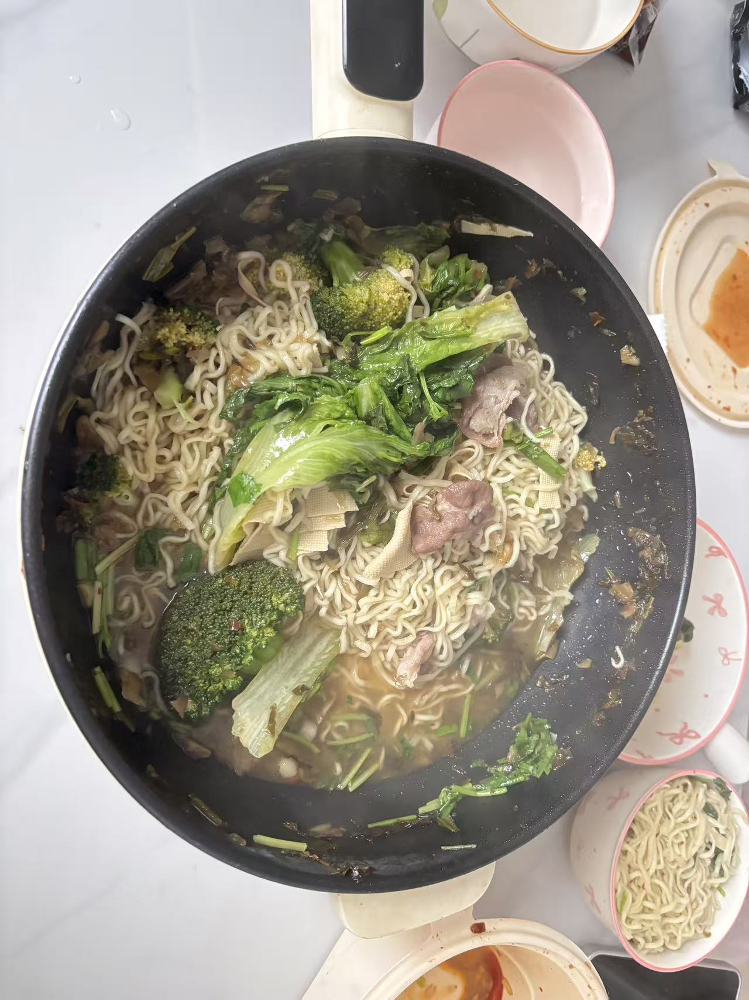
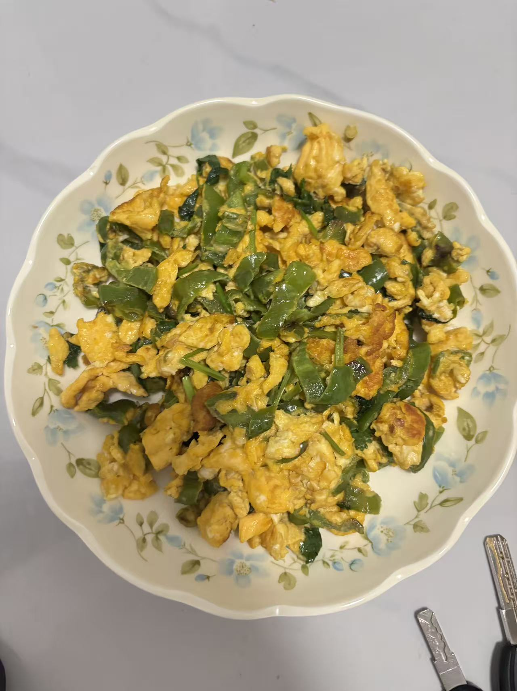
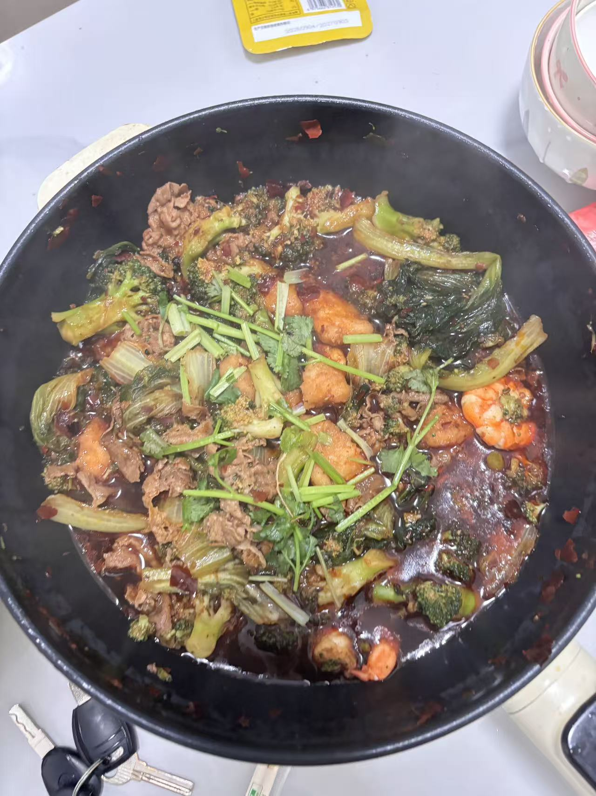
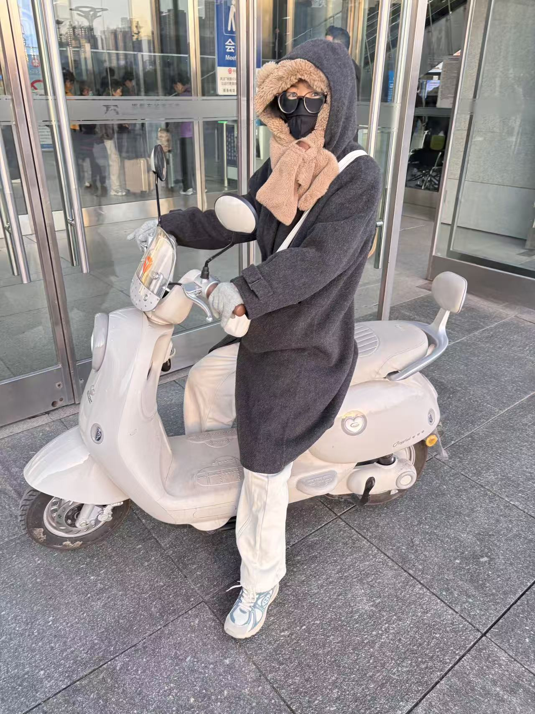

# 2026深秋

| 日期 | 事项 | 图片 |
| -- | -- | -- |
| 10.30 | 对象做了咖喱鸡肉 | x |
| 10.31 | - 早上吃的咖喱鸡肉   - 中午去逛浙江商贸城，买了一个内搭，一条裤子，一个毛衣（对象的）  - 晚上淋雨回来，雨确实蛮大的，在去看望奶奶和回家发生了一点儿争执；晚上回来吃的火锅 | x |
| 11.01 | - 早上吃的酸菜面。  - 中午在药店买了些生活日用品，只花5%就能行，真好  - 下午看了看君悦府109平的房子，又看了下罗兰春天125平的房子，都是120w，没太相中。君悦府小和罗兰春天感觉都不大    - 晚上做了辣椒炒鸡蛋。又做了麻辣香锅 |     |
| 11.02 | 周一日常惯例坐高铁回北京 |  | 

